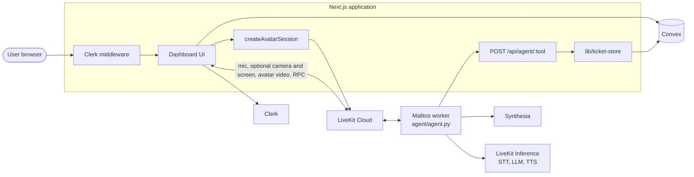
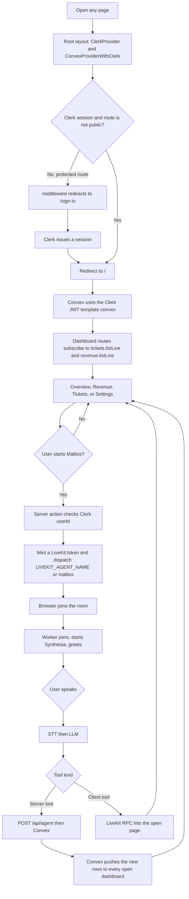
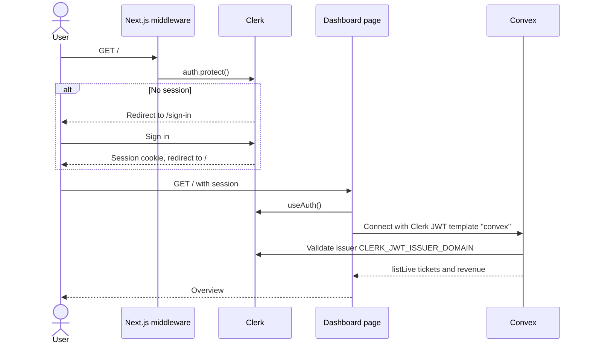
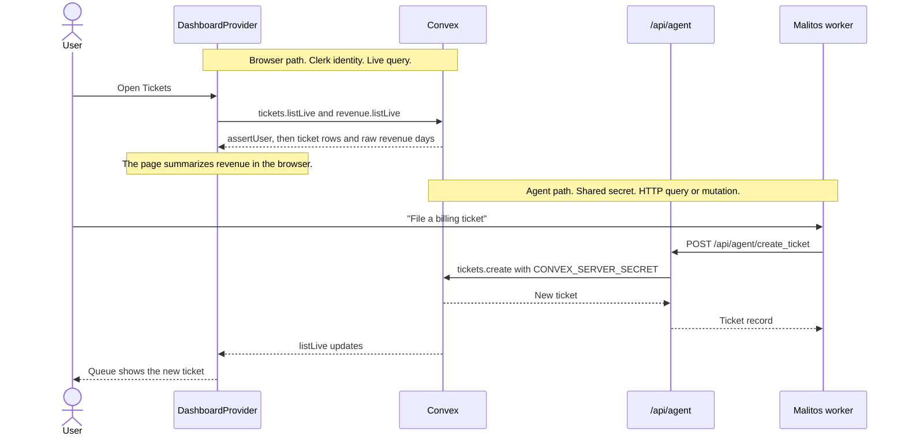
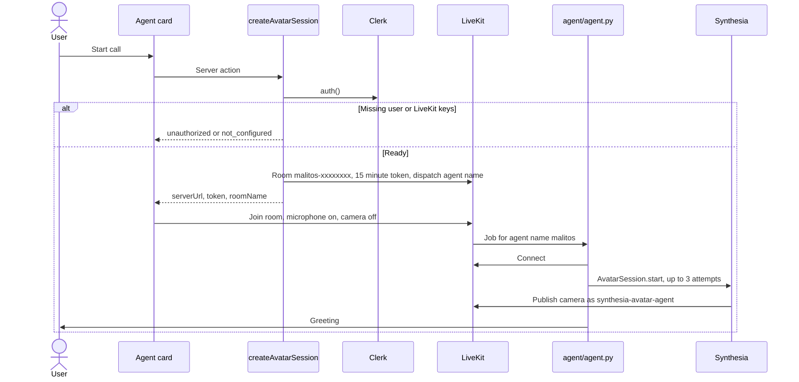
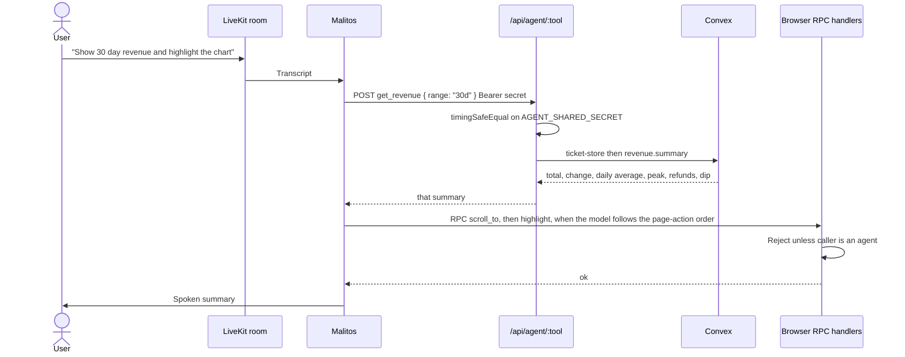
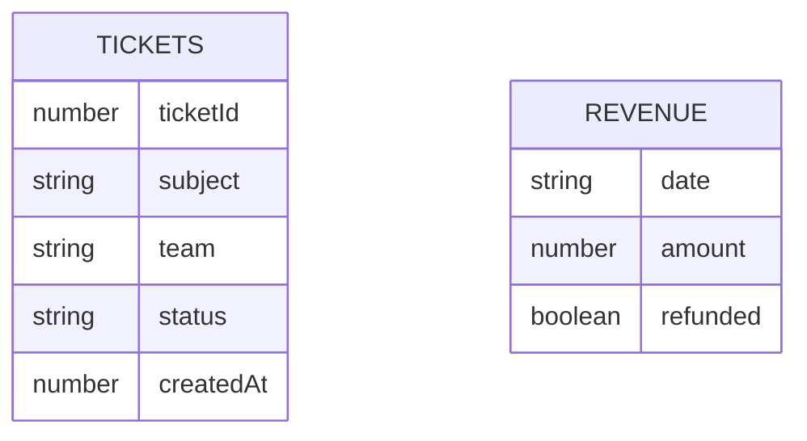
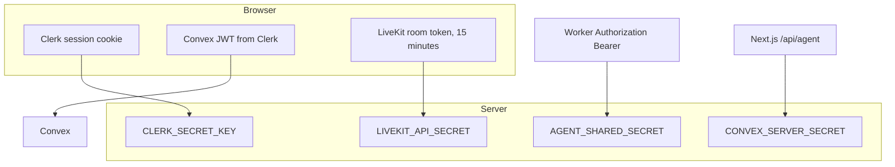

# Fintech Finance

Fintech Finance is a realtime operations dashboard. Signed-in users review revenue and support tickets. **Malitos**, an interactive AI consultant, joins the same session, speaks with the user, reads and writes the same data, and can drive the page the user is looking at.

The product is a Next.js 16 application. Identity is Clerk. Operational data is Convex. A call uses two AIs together:

- **Malitos, the agent.** A LiveKit Agents worker (`agent/agent.py`). LiveKit Inference runs speech recognition, the language model (default `openai/gpt-4.1`), and speech synthesis. The model chooses tools. Persona and tool rules are in `agent/instructions.py`.
- **Synthesia, the avatar AI.** Synthesia Interactive Avatars render Malitos as video. The LiveKit Synthesia plugin publishes that video into the room as participant `synthesia-avatar-agent`. The worker reads `SYNTHESIA_API_KEY` and, when set, `SYNTHESIA_AVATAR_ID`.

LiveKit Cloud carries the room, dispatches the worker, and bills speech and the language model. The dashboard reads `LIVEKIT_URL`, `LIVEKIT_API_KEY`, and `LIVEKIT_API_SECRET` from the environment. A second assistant, **Skit**, uses the same Synthesia and LiveKit services. This repository's worker is Malitos. Skit is not a route in this app.

Account setup is in [DOCUMENTATION.md](./DOCUMENTATION.md). This file is the architecture of the running system. The application does not call Runway.

## Contents

1. [System context](#system-context)
2. [Layers](#layers)
3. [Visit to a working session](#visit-to-a-working-session)
4. [Sequence: sign in and load the dashboard](#sequence-sign-in-and-load-the-dashboard)
5. [Sequence: live data](#sequence-live-data)
6. [Sequence: start a call with Malitos](#sequence-start-a-call-with-malitos)
7. [Sequence: a spoken request](#sequence-a-spoken-request)
8. [Integrations](#integrations)
9. [Data model](#data-model)
10. [Trust boundaries](#trust-boundaries)
11. [Repository map](#repository-map)
12. [Malitos tools](#malitos-tools)
13. [Run and verify](#run-and-verify)

## System context



The browser never holds `CONVEX_SERVER_SECRET`, the LiveKit API secret, or `AGENT_SHARED_SECRET`. Next.js holds all three. The worker uses the LiveKit API secret to join rooms and `AGENT_SHARED_SECRET` to call Next.js. It does not call Convex. `agent/agent.py` loads the root `.env`, so that file is present in the worker process even for values the worker never reads.

## Layers

| Layer | Responsibility | Where it lives |
| --- | --- | --- |
| Presentation | Pages, charts, ticket queue, settings, Malitos panel | `app/(dashboard)`, `components/` |
| Session and identity | Sign-in, route protection, Clerk session in the browser | `middleware.ts`, `app/sign-in`, `ClerkProvider` |
| Dashboard state | Live tickets and revenue, filters, info panel | `components/layout/dashboard-provider.tsx` |
| Application services | Avatar session minting, server tools, data access | `actions/avatar.ts`, `app/api/agent`, `lib/agent-tools.ts`, `lib/ticket-store.ts` |
| Agent runtime | Speech, tool choice, avatar, page control | `agent/agent.py`, `agent/instructions.py` |
| Data | Tickets and daily revenue, with two authorized callers | `convex/schema.ts`, `convex/tickets.ts`, `convex/revenue.ts` |
| External systems | Identity, realtime media, avatar, speech models | Clerk, Convex, LiveKit, Synthesia, Cartesia, the configured LLM |

The dashboard does not go through `lib/ticket-store.ts`. Signed-in pages subscribe to Convex directly. `lib/ticket-store.ts` is only the path used by `/api/agent` and by tests. The UI does not talk to Synthesia or to the language model. The worker does not query Convex. It calls the Next.js tool API, and that API is what writes and reads on the agent's behalf.

## Visit to a working session



## Sequence: sign in and load the dashboard



Public routes are only `/sign-in` and `/api/agent/*`. The agent route is public to Clerk because the worker has no user session. It is authenticated separately with `AGENT_SHARED_SECRET`.

## Sequence: live data

Two callers share one Convex deployment.



`lib/ticket-store.ts` is the server adapter used by `/api/agent` and by Vitest. When `CONVEX_URL` is set, those calls go to Convex. When it is unset, they use the in-memory demo store. The open dashboard does not use that fallback. `components/layout/providers.tsx` always constructs a Convex client from `NEXT_PUBLIC_CONVEX_URL`.

Browser queries and mutations (`listLive`, `createLive`, `updateStatusLive`, `revenue.listLive`) require a signed-in Clerk user. The browser receives revenue days and summarizes them locally. Server functions (`tickets.list`, `tickets.get`, `tickets.create`, `tickets.updateStatus`, `tickets.seed`, `revenue.summary`, `revenue.record`, `revenue.seed`) require `CONVEX_SERVER_SECRET`. The agent receives `revenue.summary`, not the raw series.

## Sequence: start a call with Malitos



Each call gets a new room so LiveKit dispatches the worker every time. The token identity is `user-{clerkUserId}`. The dispatched name is `LIVEKIT_AGENT_NAME`, or `malitos` when that variable is unset. The room sets `syncStreams` so avatar audio and video stay aligned. After join, the user can turn the camera on or share a screen. The worker sets `video_input` so Malitos can see either track. The call starts with the camera off (`video={false}` on `LiveKitRoom`).

Inside the worker, one turn is:

1. Silero voice activity detection.
2. Cartesia `ink-2` speech to text, through LiveKit Inference.
3. The configured LLM (`openai/gpt-4.1` unless `AGENT_LLM_MODEL` overrides it). Tool steps are capped at 6. Preemptive generation is off so a half-heard phrase cannot write a ticket.
4. Cartesia `sonic-3.6` text to speech.
5. Synthesia plays that speech on the avatar.

## Sequence: a spoken request

Client tools change the page. Server tools change data. The model chooses from the tools declared in `agent/agent.py`. Argument checks live in Zod on the Next.js side (`lib/tools.ts`, `lib/agent-tools.ts`) and in the worker's tool signatures.



`components/agent/client-tool-handlers.tsx` registers every client tool on the LiveKit room. A caller that is not an agent receives RPC error 1403.

## Integrations

| System | Role in this product | Contract |
| --- | --- | --- |
| Clerk | Sign-in, session, user button | `clerkMiddleware` protects routes. `ClerkProvider` wraps the tree. Convex trusts JWT template `convex`. |
| Convex | System of record for tickets and revenue | Browser: Clerk identity on `NEXT_PUBLIC_CONVEX_URL`. Agent and other server calls: `CONVEX_URL` plus `CONVEX_SERVER_SECRET`, via `lib/ticket-store.ts`. |
| LiveKit Cloud | Rooms, agent dispatch, media, RPC, inference billing | Environment: `LIVEKIT_URL`, `LIVEKIT_API_KEY`, `LIVEKIT_API_SECRET`. Default worker name `malitos`. Skit uses LiveKit the same way. |
| Synthesia | Interactive avatar video for Malitos | Environment: `SYNTHESIA_API_KEY`, optional `SYNTHESIA_AVATAR_ID`. Published as participant `synthesia-avatar-agent`. Skit uses Synthesia the same way. |
| Cartesia via LiveKit Inference | Speech to text and text to speech | Models `cartesia/ink-2` and `cartesia/sonic-3.6`. Voice `CARTESIA_VOICE_ID`. |
| LLM via LiveKit Inference | Tool-using consultant | Default `openai/gpt-4.1`. Persona and tool policy in `agent/instructions.py`. |
| Vercel | Hosts the Next.js app | `vercel.json` sets Bun install and build, a 10 second limit on the agent route, and security headers for camera, microphone, and display capture. |

The worker is a separate process (`python agent.py dev`, or the image in `agent/Dockerfile`). It reads the same root `.env` as the Next.js app. `APP_URL` is how it reaches `/api/agent`.

## Data model



- `tickets.team` is `Billing`, `Support`, or `Product`. `status` is `open` or `closed`. Indexes: `by_ticketId`, `by_createdAt`. The next id is one higher than the current maximum `ticketId`, and never lower than 4800. Seeded demo tickets are 4803 through 4812, so the first ticket created after that seed is 4813.
- `revenue` is one row per day (`YYYY-MM-DD`). `revenue.record` sets `refunded` when `amount` is negative. The table keeps 180 days so a 7, 30, or 90 day view can be compared with the previous period. The longest chart range is 90 days. Index: `by_date`.
- `tickets.seed` and `revenue.seed` load demo history only when the table is empty. Running them again returns `{ seeded: 0 }`.

Dashboard routes:

| Route | What the user sees |
| --- | --- |
| `/` | KPI overview and recent activity |
| `/revenue` | 7, 30, or 90 day chart |
| `/tickets` | Queue, filters, create and update |
| `/settings` | Theme, alerts, avatar and call readiness |
| `/sign-in` | Clerk sign-in |

## Trust boundaries



- Agent authorization uses `crypto.timingSafeEqual`. The secret must be at least 32 characters.
- Convex server checks use the same length rule.
- Response headers from `vercel.json` set `nosniff`, a strict referrer policy, and a permissions policy that allows camera, microphone, and display capture only for this origin.

## Repository map

```text
app/
  (dashboard)/          Protected pages: overview, revenue, tickets, settings
  sign-in/              Clerk sign-in
  api/agent/[tool]/     Worker-only server tools
actions/avatar.ts       LiveKit room and agent dispatch
agent/
  agent.py              Malitos worker
  instructions.py       Persona, greeting, tool policy
components/
  agent/                Panel, Synthesia stage, client RPC handlers
  layout/               Shell, providers, live dashboard context
convex/                 Schema, access checks, ticket and revenue functions
lib/
  agent-tools.ts        Server tool schemas and runners
  ticket-store.ts       Convex or in-memory adapter
  tools.ts              Client tool schemas
middleware.ts           Clerk protection
```

## Malitos tools

Every agent action has a manual path in the UI.

| Kind | Tool | Effect | Manual path |
| --- | --- | --- | --- |
| Page | `scroll_to` | Scroll a target into view | Scroll |
| Page | `highlight` | Pulse a target | Overview page-action preview |
| Page | `click` | Activate a visible target | Click the control |
| Client | `set_date_range` | 7, 30, or 90 days | Revenue range control |
| Client | `filter_tickets` | All, Open, or Billing | Tickets filter |
| Client | `open_panel` | Information panel | Insight or ticket row |
| Client | `refresh_tickets` | Acknowledges the tool. The handler is empty because `listLive` is already a live query | Refresh on Tickets calls the same empty function |
| Server | `get_overview_insights` | 30 day revenue plus queue brief | Overview insight |
| Server | `get_revenue` | Totals, change, peak, dip | Revenue insight |
| Server | `get_ticket_insights` | Queue workload | Queue insight |
| Server | `get_ticket` | One ticket by id | Ticket row |
| Server | `create_ticket` | Insert an open ticket | New ticket |
| Server | `update_ticket_status` | Close or reopen | Ticket status |

## Run and verify

Requirements: Node.js 22.13 or newer, Bun, a Clerk application, a Convex deployment, a LiveKit Cloud project, and a Synthesia interactive avatar key. The worker also needs Python and `agent/requirements.txt`.

`.env.example` lists LiveKit, Synthesia, the agent secret, and Clerk. The dashboard also needs these, which are not in that example file:

```bash
NEXT_PUBLIC_CONVEX_URL=https://your-deployment.convex.cloud
CONVEX_URL=https://your-deployment.convex.cloud
CONVEX_SERVER_SECRET=   # at least 32 characters
```

On the Convex deployment, set `CLERK_JWT_ISSUER_DOMAIN` to the Clerk Frontend API URL. `convex/auth.config.ts` expects the Clerk JWT template named `convex`.

```bash
bun install
cp .env.example .env
# then add the Convex variables above
bun dev
```

In another shell, from `agent/`:

```bash
python agent.py dev
```

Open [http://localhost:3000](http://localhost:3000). Without a Clerk session the middleware sends you to `/sign-in`.

```bash
bun dev          # Next.js
bun build        # Production build
bun typecheck    # TypeScript
bun lint         # ESLint
bun test         # Vitest, no LiveKit or Synthesia credits
```

## License

MIT © [Malit Mohamut](https://github.com/mawlid1431) — see [LICENSE](./LICENSE)
